# Case Western Reserve University (CWRU) Bearing Failure Diagnosis Codes

Including the complete CWRU bearing fault dataset, as well as the one-dimensional fault signal dataset and time-frequency image dataset that have been generated and ready for use.
Environment: Python 3.9
Preface
\t1. Python-Case Western Reserve University (CWRU) Bearing Data Interpretation and Classification Process
\t2. Python Bearing Fault Continuous Wavelet Transformation - Code and Time-Frequency Image Classification
3. Python Bearing Fault Diagnosis Time-frequency Image Processing - Short-Time Fourier Transform (STFT)
This update primarily involves optimizing the VGG16 model! It covers the processing of time-frequency images, and we have implemented the code in a relatively standard manner using Pycharm editor. Additionally, we have optimized the training process code and added a module for testing the model's time-frequency images. Students are advised to update and run according to the file interpretation afterward!
\t(Training process and classification accuracy visualization is as follows!)
1. Discussion on the Classification of Bearing Fault Types
\t1.1 Classify one-dimensional fault data
1. Firstly, directly process one-dimensional fault data with classification labels and send them into CNN, LSTM, TCN, Transformer and their composite networks for classification.
Secondly, preprocess the one-dimensional fault data or denoise it before classification.
\t1.2 Convert one-dimensional fault data into images for classification
1. Firstly, convert it into a two-dimensional sequential chart for classification;
\tSecondly, convert to time-frequency images for classification.
\tIII. Classification based on converting Gram angle field (GAF) to a two-dimensional image;
When rolling bearings fail, their vibration signals often exhibit nonlinear and non-stationary characteristics. Compared to traditional time-domain and frequency-domain analysis methods, time-frequency analysis methods are more effective in handling nonlinear and non-stationary signals.
The time-frequency analysis method employs a two-dimensional joint representation in both the time and frequency domains, capable of precise description of local characteristics of non-stationary signals. It offers advantages unmatched by traditional methods in both time and frequency domains, and has been widely applied in the field of mechanical fault diagnosis.
Common time-frequency analysis methods include:
\tFourier Transform (FT)
\tShort Time Fourier Transform (STFT)
\tWavelet Transform (WT)
Continuous Wavelet Transform (CWT)
Gram Angle Field (GAF)
2. Time-frequency image analysis based on fault signals
\t2.1 \tCase Western Reserve University Bearing Data 10-Classification Dataset
\tPython-Case Western Reserve University (CWRU) Bearing Data Interpretation and Classification Process
\t2.2 Short-Time Fourier Transform - STFT
\tPython Bearing Fault Diagnosis (Part 1): Short-Time Fourier Transform STFT
\t2.3 Continuous Wavelet Transform - CWT
\tPython Bearing Fault Diagnosis (II) Continuous Wavelet Transform CWT
2.4 Gram Angle Field Transformation - GAF
\tHigh-Innovation Bearing Fault Diagnosis Model Based on GADF+Swin-CNN-GAM
3. Innovation Recognition Model for One-Dimensional Fault Signals Based on Pytorch
3.1 Bearing Failures - Innovation Model Full Set
\tInnovative Model Family Kit
3.2 High-innovation Fault Identification Model
\tPython Bearing Fault Diagnosis (14) High-Innovation Fault Identification Model
\tPython Bearing Fault Diagnosis (16) High-Innovation Fault Identification Model (II)
3.3 Exclusive | Original | SCI 1-st Class High Innovation Bearing Fault Diagnosis Model!
\t  
\tLightweight Bearing Fault Diagnosis Innovation Network Model
- GADF+Swin-CNN-GAM high innovative bearing fault diagnosis model
- Attention modification | Super strong bearing fault diagnosis model!
Previously excellent content:
Python - Kaiser Permanente University (CWRU) bearing data interpretation and classification processing
Python bearing fault diagnosis (I) Short-time Fourier Transform STFT
Python bearing fault diagnosis (II) Continuous Wavelet Transform CWT
Python bearing fault diagnosis (III) Empirical Mode Decomposition EMD
Pytorch-LSTM bearing fault one-dimensional signal classification (I)
Pytorch-CNN bearing fault one-dimensional signal classification (II)
Pytorch-Transformer bearing fault one-dimensional signal classification (III)
Python bearing fault diagnosis (IV) Based on EMD-CNN fault classification
Python bearing fault diagnosis (V) Based on EMD-LSTM fault classification
Python bearing fault diagnosis (VI) Based on EMD-Transformer fault classification
Python bearing fault diagnosis (VII) Based on EMD-CNN-LSTM fault classification
Python bearing fault diagnosis (VIII) Based on EMD-CNN-GRU parallel model fault classification
Based on FFT + CNN - BiGRU-Attention time domain, frequency domain feature attention fusion bearing fault recognition model
Based on FFT + CNN - Transformer time domain, frequency domain feature fusion bearing fault recognition model
Python bearing fault diagnosis (IX) Based on VMD+CNN-BiLSTM fault classification
Python bearing fault diagnosis (X) Based on VMD+CNN-Transformer fault classification
Python Bearing Fault Diagnosis (11) - VM-D+CNN-BiGRU-Attenion Based Fault Classification
Cross Attention Fusion of Time and Frequency Features with FFT + CNN-BiLSTM-CrossAttention for Bearing Fault Identification Model
Cross Attention Fusion of Time and Frequency Features with FFT + CNN-Transformer-CrossAttention for Bearing Fault Identification Model
Introduction to Python Bearing Fault Diagnosis
Python Bearing Fault Diagnosis (13) - Super-strong Machine Learning Recognition Model Based on Fault Signal Feature Extraction
Python Bearing Fault Diagnosis (14) - Highly Innovative Fault Recognition Model
Python Bearing Fault Diagnosis (15) - One-Dimensional Fault Signal Recognition Model Based on CNN-Transformer
Python Bearing Fault Diagnosis (16) - Highly Innovative Fault Recognition Model (II)
SCI 1 Region High Innovation Bearing Fault Diagnosis Model!
Python Bearing Fault Diagnosis (18) - Innovative Diagnosis Model Based on CNN-TCN-Attention
Highly Innovative Bearing Fault Diagnosis Model Based on GADF+Swin-CNN-GAM
Attention Magic Modification | Super-strong Bearing Fault Diagnosis Model!
End
\t2. Friends who like this can click the follow button, give the article a "like", share in WeChat groups or discuss in discussion groups.

## Images

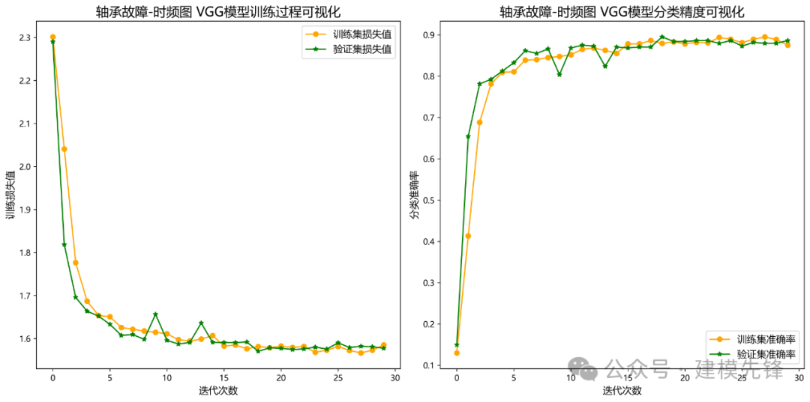
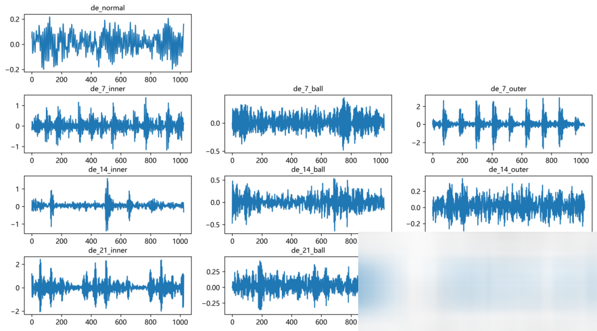
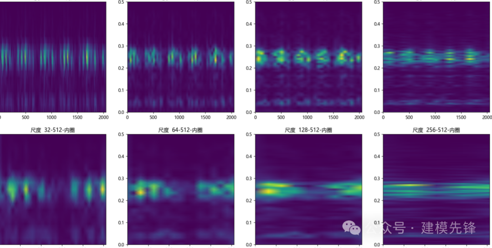
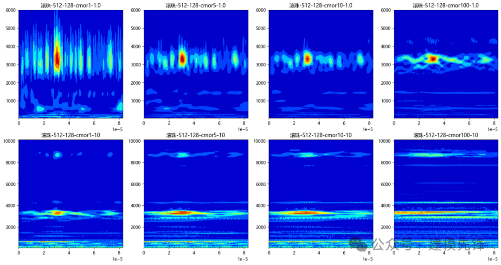
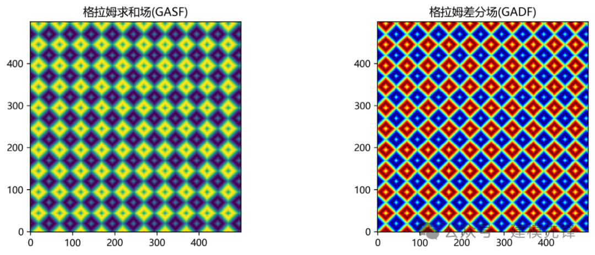
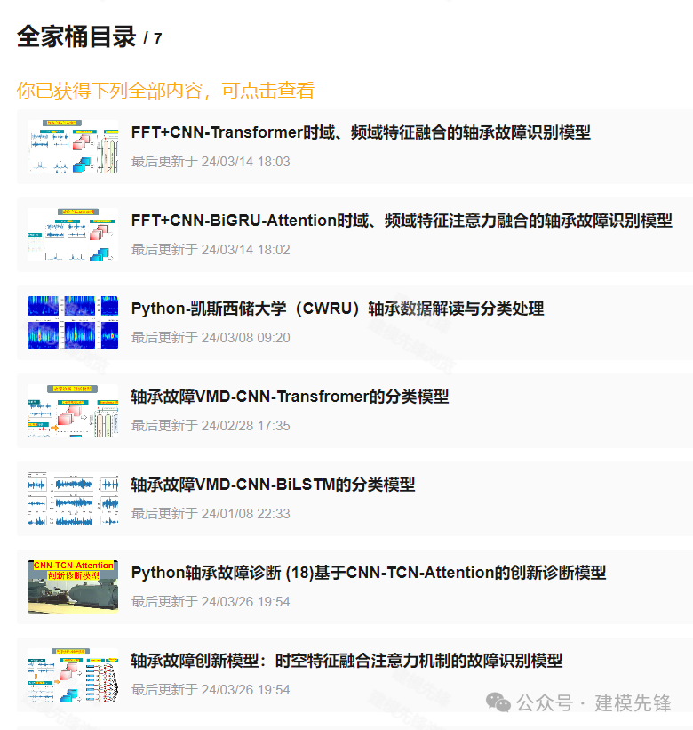
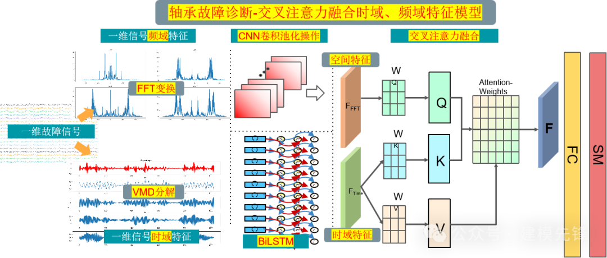
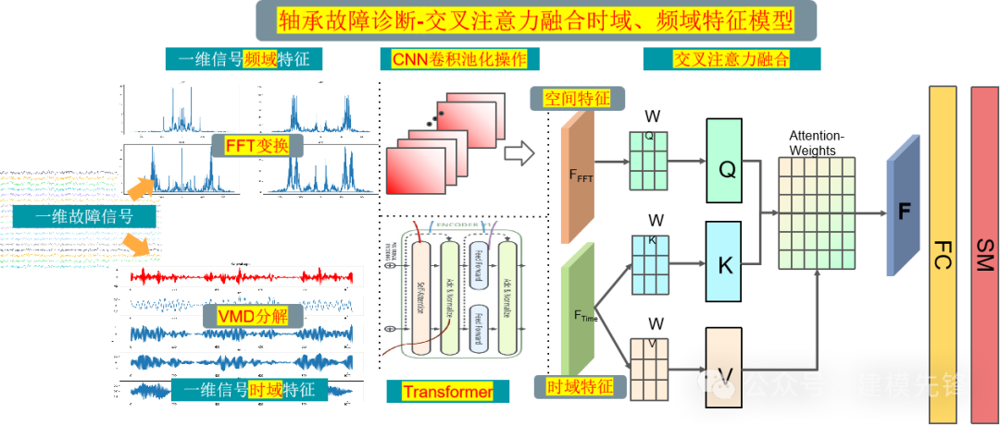
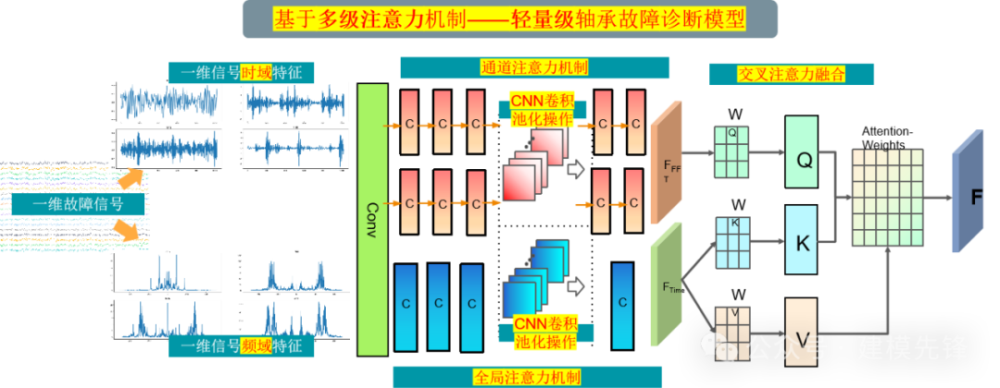
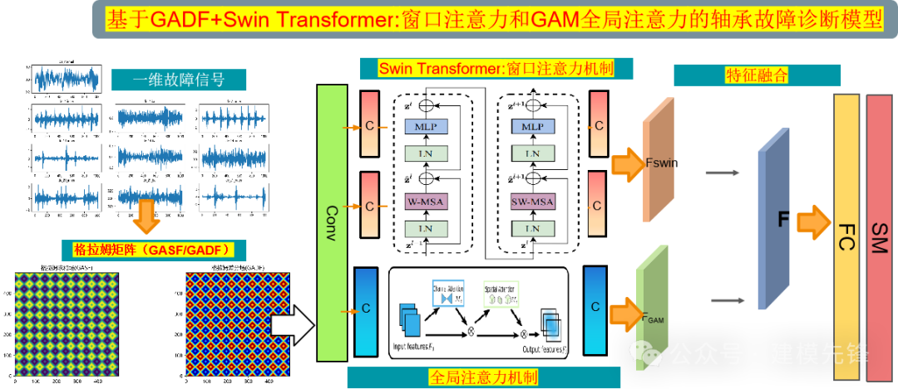
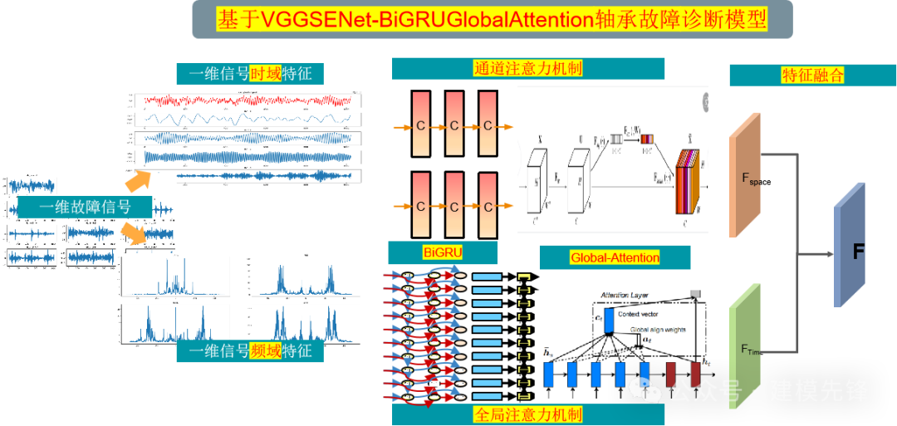

<!-- PAYMENT_BLOCK -->

## Get this dataset

- Payment link (Stripe): [Buy now](https://buy.stripe.com/3cs8yP7sY87d0vu9AB)
- Payment QR code: 

<!-- /PAYMENT_BLOCK -->
